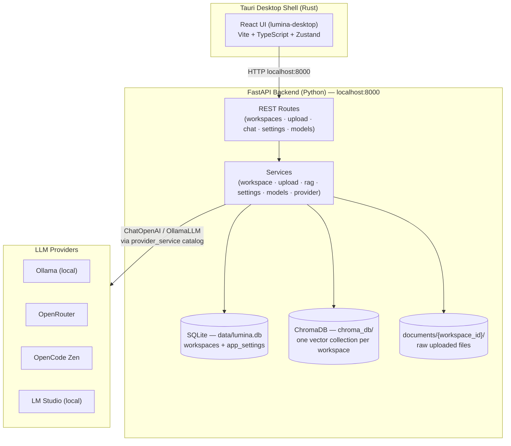
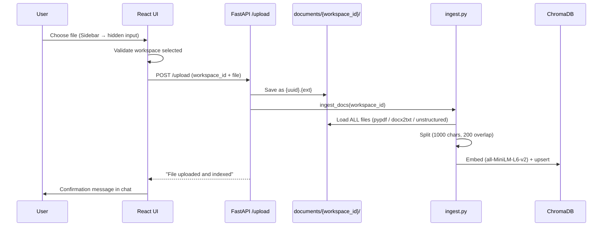
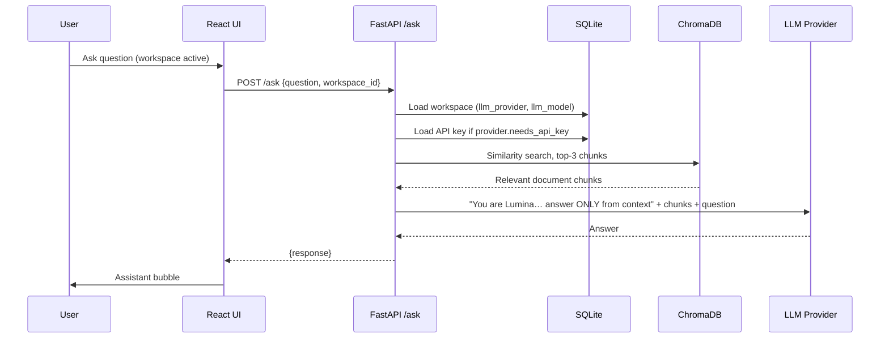

# Lumina — Architecture

Lumina is a **Personal Knowledge OS**: a local-first desktop app where users create
workspaces, upload documents (PDF / DOCX / PPTX), and chat with an AI that answers
**only** from that workspace's documents.

Think of it as a private, local NotebookLM — workspace-centric, where each workspace
is a completely independent knowledge environment.

---

## 1. High-level layout



---

## 2. Frontend structure (`lumina-desktop/src/`)

```
src/
├── main.tsx                    # React entry
├── App.tsx                     # Shell: Sidebar + ChatSession + SidePanels,
│                               # hidden file input, provider/model fetching
├── App.css                     # Single warm "editorial" theme
├── types/
│   ├── Workspace.ts
│   └── Message.ts
├── services/
│   └── api.ts                  # THE ONLY file allowed to call fetch()
├── store/
│   └── workspaceStore.ts       # Zustand: workspaces, activeWorkspaceId, actions
└── components/
    ├── Sidebar.tsx             # Logo, workspace list (from store), footer buttons
    ├── ChatSession.tsx         # Owns messages/input/loading per workspace
    │                           # (mounted with key={activeWorkspaceId} → auto-reset)
    │                           # exposes handleFileSelected() via forwardRef
    ├── ChatArea.tsx            # Message bubbles, empty state, auto-scroll
    ├── InputBar.tsx            # Enter-to-send input
    └── SidePanel.tsx           # Reusable right slide-in panel
```

**State rule:** workspace data lives only in the Zustand store; chat messages live
only inside the mounted `ChatSession`. Switching workspaces replaces the component
entirely, so no reset logic exists anywhere.

---

## 3. Backend structure (`backend/`)

```
backend/
├── app.py                      # FastAPI app, CORS, lifespan → init_db()
├── rag.py                      # Retrieval + prompt + LLM invocation
├── ingest.py                   # Load → split → embed → index documents
├── requirements.txt
├── db/
│   ├── database.py             # Engine, session, lightweight migrations
│   ├── models.py               # Workspace, AppSetting tables
│   ├── schemas.py              # Pydantic request/response models
│   └── crud.py                 # DB operations
├── routes/
│   ├── workspace.py            # /workspaces CRUD + /llm-settings
│   ├── upload.py               # POST /upload (multipart)
│   ├── chat.py                 # POST /ask
│   ├── settings.py             # GET /settings, PUT /settings/api-key
│   └── models.py               # GET /models/providers, GET /models/{provider}
└── services/
    ├── workspace_service.py
    ├── upload_service.py       # UUID filenames (path-traversal safe) + reindex
    ├── rag_service.py          # Thin wrapper over rag.ask_lumina
    ├── settings_service.py     # Per-provider API keys (api_key:{provider})
    ├── models_service.py       # Live model lists, cached 10 min
    └── provider_service.py     # THE provider catalog (single source of truth)
```

---

## 4. Upload flow (document ingestion)



> ⚠️ **Known issue:** every upload re-indexes *all* files in the workspace folder,
> duplicating previously-ingested chunks in Chroma (needs a collection reset or
> incremental ingestion).

---

## 5. Ask flow (RAG chat)



Provider selection (`rag._get_llm`) reads the catalog in `provider_service.py`:

| Provider | Kind | Base URL | API key |
|---|---|---|---|
| Ollama | native | `localhost:11434` | — |
| OpenRouter | OpenAI-compatible | `openrouter.ai/api/v1` | ✅ |
| OpenCode Zen | OpenAI-compatible | `opencode.ai/zen/v1` | ✅ |
| LM Studio | OpenAI-compatible | `localhost:1234/v1` | — |

Native Ollama → `OllamaLLM`. Everything else → `ChatOpenAI` with that provider's
`base_url`. **Adding a new provider = one entry in the catalog, nothing else.**

---

## 6. Data isolation model

Every artifact is keyed by `workspace_id`:

```
SQLite      workspaces row ──────────────┐
documents/  {workspace_id}/…             │ same ID
chroma_db/  collection = {workspace_id} ─┘
Frontend    ChatSession key = {workspace_id}
```

Delete a workspace and its row is removed (⚠️ documents folder + Chroma collection
cleanup is a known pending fix).

---

## 7. Running it

```bash
# Backend (terminal 1)
cd backend
./venv/bin/python -m uvicorn app:app --port 8000

# Frontend dev (terminal 2)
cd lumina-desktop
npm run dev                    # browser at localhost:5173

# Native desktop app
npm run tauri:dev              # dev window
npm run tauri:build            # production binary
```
